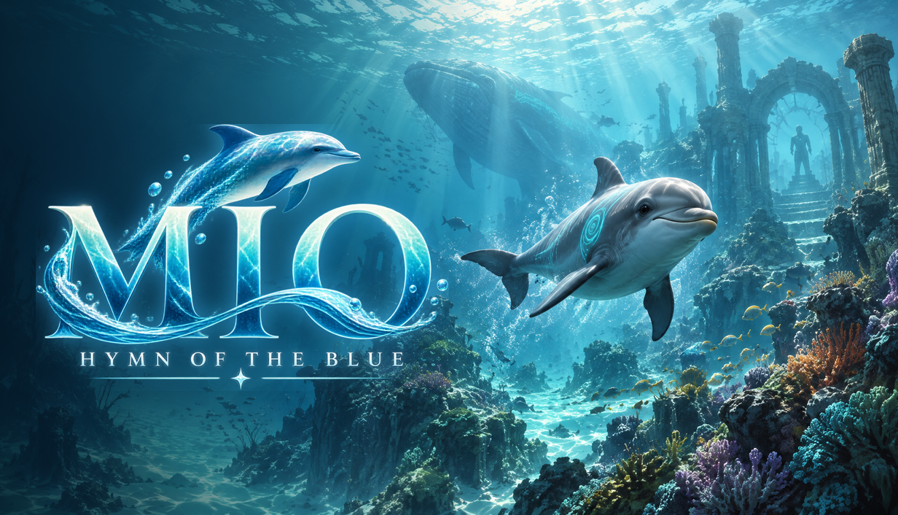

# 澪 ―蒼の讃歌―（MIO - Hymn of the Blue）

横から見た海を、若いイルカ「澪（ミオ）」が泳ぐ 2D アクションアドベンチャーです。
メガドライブ時代の「イルカの横スクロール」の手触りを出発点にした**オリジナル作品**で、
キャラクター・世界・名称はすべて独自のものです（既存作品の名前・設定・素材は使っていません）。



## 見どころ：多重スクロールと半透明の海

| 層（奥から） | 視差 | 中身 |
|---|---|---|
| 空 | 0.03 | 水面より上に見える空（ステージごとに昼・午後・夕・夜の色） |
| 遠景シルエット ×2 | 0.14 / 0.26 | 霞んだ岩礁・昆布林・神殿・海溝。深さに応じて水の色に溶ける |
| 遠くの生き物 | 0.15〜0.55 | 鯨・マンタ・海亀が奥の層をゆっくり横切る |
| 中景 | 0.5 | 珊瑚・岩・神像。コースティクス（揺れる光の網）が乗る |
| 光の柱 | 0.6 | 水面から差し込む光（加算合成） |
| 浮遊物（奥） | 0.6 | マリンスノー |
| 海草・岩・キャラクター | 1.0 | 遊ぶ層。岩は密度場から描画し、上面に苔・珊瑚、縁に水の散乱光 |
| 浮遊物（手前） | 1.0 / 1.6 | マリンスノーとピンぼけの光の粒（ボケ） |
| 前景シルエット | 1.4 | 画面手前をぼかした暗い影が横切る |

その上に画面全体の処理を重ねています。

- 水中のゆらぎ（屈折の歪み）、水面のきらめく境界線と水面下の反射
- 深さで暗くなる海と、イルカ・クラゲ・泉・歌石などの**光源バッファ**（深海ほど光が際立つ）
- 声（ソナー）の波紋による空間の歪みと光
- ブルーム、ACES トーンマップ、周辺減光、色収差、フィルムグレイン

## 遊び方

| 操作 | キーボード | ゲームパッド |
|---|---|---|
| 泳ぐ | 方向キー / WASD | 左スティック / 十字キー |
| 声（ソナー）／長押しで〈歌〉 | Z / Space / J | Ⓐ |
| ダッシュ（体当たり） | X / Shift / K | Ⓑ / Ⓧ |
| ポーズ | Esc / P | Start |
| フルスクリーン切替（製品版） | F11 / Alt+Enter | — |

- 空気：左上のバーが尽きると体力が減ります。水面に出るか、海底から湧く泡の柱で回復します。
- 勢いよく水面を抜けると空へ跳びます（空中でダッシュすると回転）。
- 声は歌石と語り、クラゲを怯ませます。溜めた〈歌〉は水晶の門を開き、静寂の泡に囚われた仲間を目覚めさせます。
- 小魚を食べると体力が回復します。鮫はダッシュの体当たりで撃退できます。
- 各章の仲間をすべて見つけると、出口の「潮の道」が開きます。
- 終章のボス〈静寂〉は、〈歌〉で背中の核を光らせ、光っている間にダッシュで体当たりして倒します。

全4章：珊瑚の浅瀬 → 昆布の大聖堂 → 沈んだ神殿 → 深淵（ボス戦）。日本語・英語に対応。
音楽と効果音はすべて WebAudio でその場で合成しています（音声ファイルなし）。

## 動かし方

```bash
npm install
npm start               # Electron 版（Steam で配る形）
npm run serve           # ブラウザ版: http://localhost:8080/
                        #   ?stage=2 で章を直接開始、?q=low|medium|high で画質を上書き
```

製品ビルド（`dist/` に出力。Steam へはこのフォルダをアップロードします）:

```bash
npm run dist:win        # dist/win-unpacked/
npm run dist:linux      # dist/linux-unpacked/（Steam Deck のネイティブ版にも使える）
npm run dist:mac        # dist/mac-universal/（macOS 上でのみ。Mac がなければ GitHub Actions で。STEAM.md 参照）
```

## フォルダ構成

```
web/                 ゲーム本体（index.html と ES モジュール。ビルド工程なし）
  src/renderer.js    描画パイプライン（多重スクロール・光源バッファ・ポストエフェクト）
  src/shaders.js     GLSL（水・空・層・光の柱・岩・ゆらぎ・ブルーム・合成）
  src/terrain.js     地形の密度場と距離場（当たり判定・到達判定）
  src/levels.js      4章のレイアウト・配色・層の設定
  src/game.js        ステージの進行（声の波紋・門・仲間・出口・カメラ）
  src/player.js      澪の泳ぎ・跳躍・息・声・ダッシュ
  src/entities.js    魚群・クラゲ・鮫・仲間・パーティクル
  src/boss.js        ボス〈静寂〉
  src/draw.js        スプライトの曲げ描画（1枚絵を背骨に沿って曲げて泳がせる）
  src/audio.js       音楽・環境音・効果音の合成
  src/ui.js, main.js HUD・メニュー・章の流れ・セーブ
  assets/img/        ゲーム用に加工した画像（WebP）
  fonts/             Zen Maru Gothic / Cormorant Garamond（SIL OFL）
electron/            Steam 用デスクトップ版（Steamworks の実績・オーバーレイ）
assets_src/          生成画像の元データ（WebP）とプロンプト記録（.json）
store/               Steam ストア用画像（各カプセル・ヒーロー・ロゴ・アイコン・スクリーンショット）
steam/               SteamPipe のアップロード設定（App ID / Depot ID は要差し替え）
tools/               画像生成・加工、検証スクリプト
```

## 画像の作り方（GPT Image 2.5）

画像は `gpt-image-2.5` スキルで生成しています（いまは下書き品質 `medium`）。

```bash
python3 tools/gen_assets.py            # tools/asset_prompts.json の未生成分を作る（assets_src/）
python3 tools/gen_assets.py mio shark  # 指定したものだけ作り直す
python3 tools/process_assets.py        # 切り抜き・縮小して web/assets/img/ に WebP で書き出す
python3 tools/make_store_assets.py     # Steam 用の各サイズとアイコンを合成する
```

発売前に仕上げる場合は、気に入った下書きをスキルの `release`（`xhigh` 品質）で描き直してから
`process_assets.py` と `make_store_assets.py` をもう一度実行してください。

## 検証

```bash
node tools/validate_levels.mjs   # 全章で歌石・仲間・真珠・出口に澪が通れる道があるか
node tools/sim_test.mjs          # 操作を自動で流し、門・仲間・出口・ボス撃破・溺れて復活までを確認
npm run serve & node tools/shot.js <出力先> "1:2600,380:5:名前"   # 指定位置のスクリーンショット
```

## いまの到達点と、製品として出す前に必要なこと

正直に書くと、これは「AAA の見た目を目指した縦切り（バーティカルスライス）」です。
AAA タイトルは通常、数十〜数百人が数年かけて作るもので、ここにあるのはその品質の方向性を示す
完成版の小規模作品（4章・30〜60分程度）です。販売までに次を推奨します。

1. **実機での性能確認**：開発環境は GPU がなくソフトウェア描画でしか確認できていません。
   Windows の内蔵 GPU / 単体 GPU と Steam Deck で 60fps 出るか確かめ、必要なら画質「中」を既定にしてください。
2. **テストプレイ**：難易度（空気の量・鮫の速さ・ボスの攻撃間隔）は `player.js` の `P` と `boss.js` で調整できます。
3. **画像の本番品質化**：上記の `release`（xhigh）で仕上げ。
4. **音**：合成音でも成立していますが、作曲家による音楽・効果音に差し替えると印象が大きく上がります。
5. **キー割り当て変更・字幕サイズなどのアクセシビリティ設定**、Steam クラウドセーブの設定。
6. Steam への登録手続き（[STEAM.md](STEAM.md)）。
